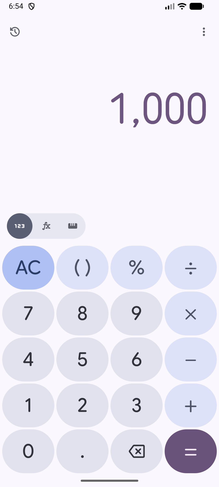
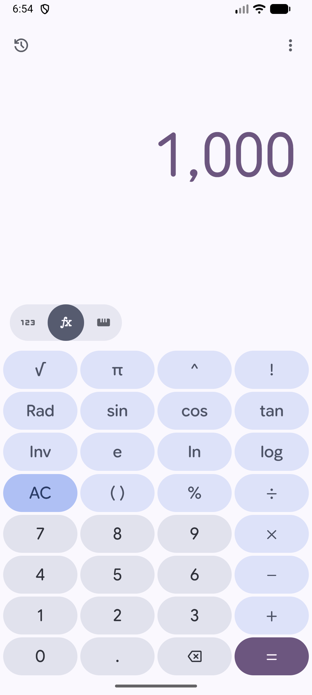
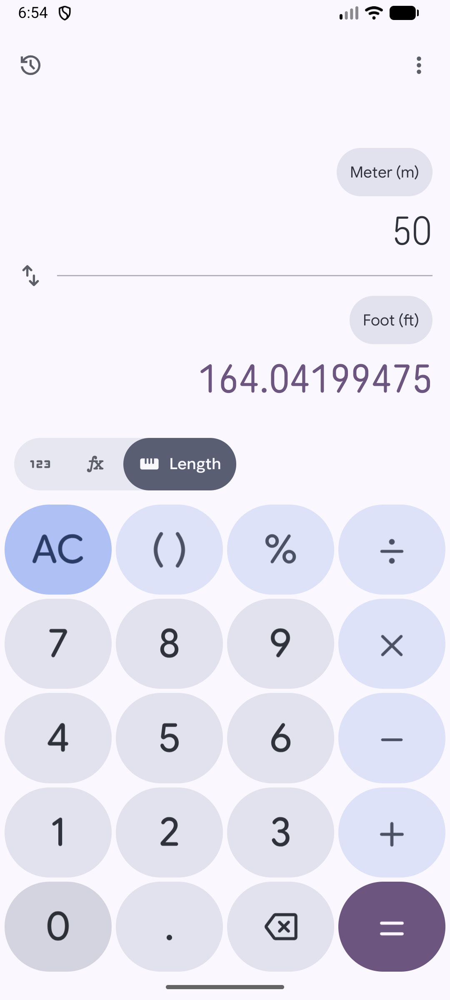
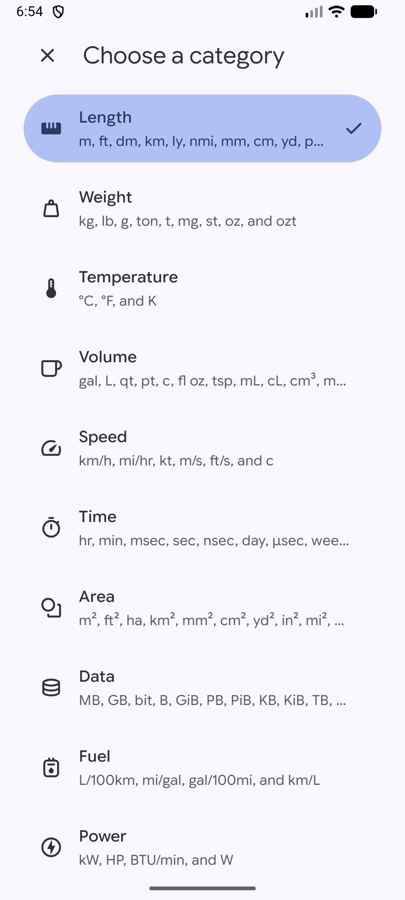

<div align="center">

# Pixel Calculator

**Google Calculator (v10.0+) modification unlocking Google Pixel-exclusive features on any Android device running Android 12 or newer [No Root].**

<p>
  <a href="https://github.com/Akshayykadam/Pixel-Calculator/releases">
    
  </a>
  
  
  
  
  
</p>

<!-- Primary Action: 1-Click Direct Download Links -->
<p>
  <a href="Pixel_Calculator_Modded.apk">
    
  </a>
</p>

</div>

---

## Screenshots

| Basic Calculator | Scientific Calculator | Rosetta Unit Converter | Conversion Categories |
| :---: | :---: | :---: | :---: |
|  |  |  |  |
| **Clean Material You UI** with calculation tape & Monet theming | **Advanced Scientific Pad** with trig, logarithms, roots & $\pi, e$ | **Universal Unit Converter** (real-time bi-directional conversion) | **Multi-Category Hub**: Length, Weight, Temperature, Volume, Speed... |

---

## Overview

Starting with version 10.0, Google Calculator introduced integrated productivity tools:
1. **Rosetta Unit Converter**: Multi-category unit and live currency converter integrated into the calculator UI.
2. **Pixel Solver (Abacus / Ask Math)**: Equation canvas, handwritten math solver, and custom formula storage ("My Tools").

Google enforces hardware restrictions on non-Pixel devices via `PackageManager.hasSystemFeature("com.google.android.feature.PIXEL_EXPERIENCE")` and remote Phenotype configuration flags.

**Pixel Calculator Mod** bypasses hardware checks, overrides Phenotype flag providers, resolves DroidGuard signature verification crashes, and re-scopes the package so it can be installed alongside the stock calculator on any Android device without root.

---

## Features

### 1. Unit Conversion (Codename: Rosetta)
- **Universal Availability**: Fully operational on any Android device without Pixel hardware or custom ROMs.
- **Conversion Categories**:
  - **Length**: Meters, kilometers, centimeters, millimeters, miles, yards, feet, inches, nautical miles.
  - **Area**: Square meters, square kilometers, square feet, square inches, hectares, acres.
  - **Volume**: Liters, milliliters, gallons (US & UK), quarts, pints, cups, fluid ounces, cubic meters.
  - **Mass & Weight**: Kilograms, grams, milligrams, metric tons, pounds, ounces, stones.
  - **Temperature**: Celsius, Fahrenheit, Kelvin (real-time dynamic recalculation).
  - **Speed**: Meters per second, kilometers per hour, miles per hour, knots, Mach.
  - **Time**: Seconds, minutes, hours, days, weeks, months, years.
  - **Digital Data Storage**: Bytes, Kilobytes (KB), Megabytes (MB), Gigabytes (GB), Terabytes (TB), Petabytes (PB).
  - **Live Currency Rates**: Live exchange rates with local offline cache support.
- **Bi-Directional Calculation**: Modifying either field automatically recalculates the opposite unit in real time.
- **Implementation**:
  - Overrides hardware check in `gww.smali` (`c()Z`).
  - Forces Phenotype flag `45810769` (Rosetta master switch) to return `true` in `jtw.smali`.
  - Forces Phenotype flag `45814182` (Non-Pixel fallback check) to return `true` in `jtt.smali`.

### 2. Pixel Solver & Formula Canvas (Codename: Abacus / Ask Math) — *Disabled*
- **Current Status**: Temporarily disabled to deliver a streamlined, offline-first experience without external AI services or cloud API keys.
- **Implementation**: Phenotype master flag `45814179` in `jtn.smali` and `jtq.smali` returns `false` (`0`), cleanly removing the Ask Math button from the interface. Local mathematical models and bytecode patches remain preserved for future offline integration.

### 3. Package Coexistence Mode (Dual Installation)
- **Package Name**: `com.google.android.pixelcalculator`
- **Application Label**: `Pixel Calculator`
- **Side-by-Side Coexistence**: Can be installed on any device that already has the factory Google Calculator (`com.google.android.calculator`) installed, without uninstallation, root, or package conflicts.
- **Manifest Adjustments**:
  - Stripped `original-package` declaration to prevent system package signature collisions.
  - Remapped `MlKitInitProvider` authority to `com.google.android.pixelcalculator.mlkitinitprovider`.
  - Re-scoped internal dynamic broadcast permissions to `com.google.android.pixelcalculator.DYNAMIC_RECEIVER_NOT_EXPORTED_PERMISSION`.

### 4. GMS DroidGuard Security Crash Bypass
- **The Issue**: When modifying the package name and signing with a custom keystore, Google Play Services (GMS) DroidGuard (`com.google.android.gms.droidguard.service.START`) throws `java.lang.SecurityException: PackageVerificationRslt: not allowed` upon caller verification.
- **Original Behavior**: `BaseGmsClient.r()` in `fuf.smali` rethrew `SecurityException` across the `DG` thread, causing an immediate fatal process crash.
- **The Fix**: The catch block is rerouted to the disconnect handler (`:goto_4`), gracefully falling back to status `SERVICE_UNAVAILABLE` without crashing.

### 5. Standalone Single-APK Architecture
- Native 64-bit binaries (`lib/arm64-v8a`) are extracted from split APKs and embedded directly into the base package.
- Stripped `com.android.vending.splits.required` and `splits0` resource declarations.
- Configured `doNotCompress` in `apktool.yml` for `.so` libraries to maintain memory-mapped execution.
- Installs via standard Android package installers, file managers, or ADB without requiring split-APK tools (SAI, Shizuku, APKM).

### 6. Material You Dynamic Theming
- Native dynamic color extraction (Monet) on Android 12, 13, 14, and 15+.
- Automatic Light and Dark theme switching based on system preferences.
- Standard calculation tape, memory functions ($M+$, $M-$, $MR$, $MC$), and scientific operations (trigonometric, inverse, logarithmic, powers, roots, constants $\pi$, $e$).

---

## Feature Comparison Matrix

| Feature                        | Stock Google Calculator (Non-Pixel) | Pixel Calculator Mod (Any Android 12+)             |
| ------------------------------ | ----------------------------------- | -------------------------------------------------- |
| Basic & Scientific Math        | Yes                                 | **Yes**                                            |
| Calculation History Tape       | Yes                                 | **Yes**                                            |
| Material You Dynamic Colors    | Yes                                 | **Yes**                                            |
| Rosetta Unit Converter         | Locked                              | **Unlocked**                                       |
| Live Currency Exchange Rates   | Locked                              | **Unlocked**                                       |
| Pixel Solver / Canvas (Abacus) | Locked                              | **Disabled (Removed for now)**                     |
| Coexistence (Dual Install)     | No                                  | **Yes (**`com.google.android.pixelcalculator`**)** |
| Single Standalone APK          | No (Split APK)                      | **Yes (Self-Contained)**                           |
| Root Requirement               | None                                | **None**                                           |

---

## Installation Guide

### Option 1: Sideloading the Pre-Built APK (Recommended)

1. Download [**Pixel_Calculator_Modded.apk**](Pixel_Calculator_Modded.apk) (directly included in the root of this repo, or from [Releases](https://github.com/Akshayykadam/Pixel-Calculator/releases/latest)).
2. Tap the file in your browser downloads or file manager.
3. If prompted by Android, grant **Install unknown apps** permission.
4. Tap **Install**.
5. Launch **Pixel Calculator** from your app drawer.

*(ADB command: `adb install -r Pixel_Calculator_Modded.apk`)*

### Option 2: Automated Build Pipeline (`scripts/pipeline.sh` / `build.sh`)

To compile and sign the package from source:

#### Prerequisites
- JDK 17+
- Apktool (v2.9.0 or higher)
- Android SDK Build-Tools (`zipalign` and `apksigner`)

```bash
# Clone the repository
git clone https://github.com/Akshayykadam/Pixel-Calculator.git
cd Pixel-Calculator

# Make scripts executable
chmod +x build.sh scripts/*.sh

# Run end-to-end pipeline from a base APK or APKM bundle
./scripts/pipeline.sh path/to/GoogleCalculator.apkm

# Or fast recompile existing decoded_apk:
./build.sh
```

The script will decompile, extract native 64-bit libraries, apply smali patches sequentially, inject the offline/online solver engine, perform 4-byte/16KB page alignment, sign with debug credentials (v1, v2, v3 schemes), and output the final package to `dist/Pixel_Calculator_Modded.apk`.

For more details, see [docs/BUILD_GUIDE.md](docs/BUILD_GUIDE.md).

### Option 3: Manual Smali Patch Application

```bash
# Decompile base APK
apktool d base.apk -o decoded_apk -f

# Extract native libraries from split config
./scripts/extract-splits.sh split_config.arm64_v8a.apk decoded_apk/

# Apply patches and solver engine sequentially
./scripts/apply-patches.sh decoded_apk

# Build, align, and sign
./scripts/build.sh decoded_apk dist
```

---

## Technical Specifications & Smali Modifications

| Target Class | Method | Original Logic | Patched Logic | Functional Purpose |
| :--- | :--- | :--- | :--- | :--- |
| `gww` | `c()Z` | Queries `hasSystemFeature("com.google.android.feature.PIXEL_EXPERIENCE")` | Returns `true` (`const/4 v0, 0x1`) | Bypasses Pixel hardware checks |
| `jtw` | `p()Z` | Evaluates Phenotype flag `45810769` | Returns `true` (`const/4 v0, 0x1`) | Activates Rosetta unit converter switch |
| `jtt` | `b()Z` | Evaluates Phenotype flag `45814182` | Returns `true` (`const/4 v0, 0x1`) | Enables non-Pixel converter fallback |
| `jtn` | `d()Z` | Evaluates Phenotype flag `45814179` | Returns `true` (`const/4 v0, 0x1`) | Activates Abacus (Pixel Solver) switch |
| `jtq` | `i()Z` | Evaluates flag `45814179` via provider | Returns `true` (`const/4 v0, 0x1`) | Bypasses Abacus provider check |
| `fuf` | `r(Lfve;Ljava/util/Set;)V` | Rethrows `SecurityException` (`throw v0`) | Reroutes to `:goto_4` fallback | Converts DroidGuard crash to graceful disconnect |
| `erz` | `a(AiModelRequest;kpx;)Ljava/lang/Object;` | Remote gRPC call to `pixelmerlin-pa.googleapis.com` | Calls `PixelSolverEngine.solve(query)` | Real-time online solver & interactive GenUI engine |

---

## Compatibility

- **Android Versions**: Android 12 (API 32), Android 13 (API 33), Android 14 (API 34), Android 15 (API 35+)
- **Architecture**: `arm64-v8a` (64-bit)
- **Root**: Not required (100% non-root friendly)
- **Tested Skins & Environments**:
  - Samsung One UI (4.x / 5.x / 6.x / 7.x)
  - OnePlus / OPPO / Realme (OxygenOS / ColorOS / Realme UI)
  - Xiaomi / Redmi / POCO (HyperOS / MIUI)
  - Motorola (Hello UI / My UX)
  - Nothing OS
  - Google Pixel (stock & custom ROMs)
  - AOSP & Custom ROMs (LineageOS, PixelOS, crDroid, Evolution X)

---

## Repository Structure

```
Pixel-Calculator/
├── .github/
│   ├── workflows/
│   │   ├── ci.yml                                  # GitHub Actions CI (build, test, script lint)
│   │   └── build-apk.yml                           # GitHub Actions automated packaging workflow
│   ├── ISSUE_TEMPLATE/
│   │   ├── bug_report.yml                          # Structured bug report form
│   │   ├── feature_request.yml                     # Feature suggestion template
│   │   └── config.yml                              # Community discussion links
│   └── pull_request_template.md                    # Pull request validation checklist
├── Pixel_Calculator_Modded.apk                     # Standalone signed modded APK (included directly)
├── assets/
│   └── screenshots/                                # Live screenshots (Basic, Scientific, Unit Converter)
├── dist/
│   └── Pixel_Calculator_Modded.apk                 # 16KB-aligned and signed distribution package
├── docs/
│   ├── ARCHITECTURE.md                             # Reverse engineering & bytecode architecture
│   └── BUILD_GUIDE.md                              # Detailed build & installation manual
├── scripts/
│   ├── build.sh                                    # Recompile, 16KB align, and sign script
│   ├── apply-patches.sh                            # Automated smali patch injector
│   ├── extract-splits.sh                           # 64-bit native library extractor
│   └── pipeline.sh                                 # End-to-end automated build pipeline
├── patches/
│   └── smali/
│       ├── 01-unlock-unit-conversion.patch         # Rosetta unit conversion patch
│       ├── 02-unlock-pixel-solver.patch            # Abacus math solver patch
│       ├── 03-change-package-name.patch            # Coexistence package remapping patch
│       ├── 04-standalone-splits-fix.patch          # Single-APK native lib configuration
│       ├── 05-bypass-gms-security-exception.patch  # DroidGuard SecurityException bypass
│       ├── 06-pixel-solver-offline-engine.patch    # Offline Pixel Solver engine patch
│       └── solver/                                 # PixelSolverEngine smali bytecode
├── src/
│   ├── main/
│   │   ├── java/
│   │   │   └── com/android/calculator2/abacus/solver/
│   │   │       └── PixelSolverEngine.java          # Local & online solver engine implementation
│   │   └── kotlin/
│   │       └── app/morphe/patches/google/calculator/
│   │           ├── Fingerprints.kt                 # Bytecode signature definitions
│   │           ├── UnlockUnitConversionPatch.kt    # Morphe patch for Rosetta
│   │           ├── UnlockPixelSolverPatch.kt       # Morphe patch for Abacus
│   │           ├── ChangePackageNamePatch.kt       # Morphe patch for package name
│   │           └── BypassGmsSecurityExceptionPatch.kt # Morphe patch for GMS bypass
│   └── test/
│       ├── java/
│       │   └── com/android/calculator2/abacus/solver/
│       │       └── PixelSolverEngineTest.java      # Solver engine test suite
│       └── kotlin/
│           └── app/morphe/patches/google/calculator/
│               └── PatchMetadataTest.kt            # Patch metadata validation tests
├── build.gradle.kts                                # Gradle build configuration
├── settings.gradle.kts                             # Gradle project settings
├── gradlew / gradlew.bat                           # Gradle wrapper executables
├── build.sh                                        # Top-level quick build entry point
├── CONTRIBUTING.md                                 # Contribution guidelines & setup instructions
├── SECURITY.md                                     # Vulnerability disclosure policy
├── LICENSE                                         # Apache 2.0 license
├── .gitattributes                                  # Line ending normalization rules
└── .gitignore                                      # Build artifact exclusions
```

---

## Frequently Asked Questions (FAQ)

**Q: Can this be installed without uninstalling the original Google Calculator?**  
Yes. The package is renamed to `com.google.android.pixelcalculator`. Both apps can run simultaneously without conflicts.

**Q: Does this mod require root, Magisk, or KernelSU?**  
No. The APK is signed with standard Android v1/v2/v3 signatures and installs like any standard application.

**Q: Why does Google Play Protect show a warning when installing?**  
Because the package is signed with a custom certificate rather than Google's official release key, Play Protect may display an "Unrecognized developer" notification. Tap **More details** > **Install anyway**.

**Q: Where is the Ask Math (AI) feature?**  
Ask Math has been temporarily removed/disabled to provide a 100% offline-first experience with zero cloud dependencies, network tracking, or API key requirements. Rosetta Unit Conversion, Scientific calculations, and Dual Installation remain fully active.

**Q: Do I need an internet connection or Google API keys?**  
No. The modded application is completely offline, requires no API keys, and has no external AI network dependencies.

---

## License & Disclaimer

- **License**: Licensed under the [Apache License 2.0](LICENSE).
- **Disclaimer**: Google, Google Pixel, Google Calculator, Material You, and Android are trademarks of Google LLC. This project is an independent modification developed for research, interoperability, and educational purposes, and is not affiliated with or endorsed by Google LLC.
